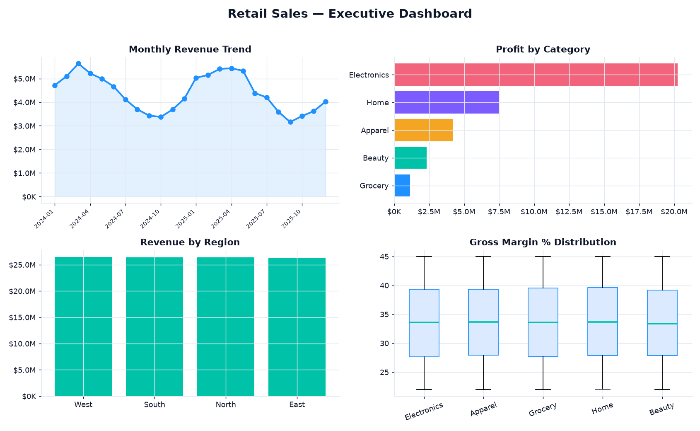

# 🛍️ Retail Sales Analytics

> End-to-end exploratory analysis and executive KPI reporting on a synthetic
> multi-category, multi-region retail dataset — the same reporting pattern I
> build in **Power BI**, expressed in **Python / pandas**.

<p>
  
  
  
  
  
</p>

---

## 📊 Executive dashboard

Generated by `src/analysis.py` from ~14,600 daily rows (5 categories × 4 regions × 2 years):



---

## Why this project

Every retail leadership team asks the same four questions: *Are we growing? What's
making the money? Where is it coming from? And how healthy are our margins?* This
project answers all four from raw transactions — a governed KPI layer, an
opinionated set of visuals, and plain-language findings — so the numbers are
trustworthy and the story is obvious.

## What it does

| Stage | File | Output |
|---|---|---|
| **Generate** a realistic dataset (seasonality, weekend uplift, category cost/margin structure) | `src/generate_data.py` | `data/retail_sales.csv` |
| **Compute** the executive KPI set (single source of truth) | `src/analysis.py → kpis()` | `outputs/kpis.json` |
| **Explain** the numbers as plain-language findings | `src/analysis.py → insights()` | console |
| **Visualise** a one-page executive dashboard + standalone charts | `src/analysis.py → dashboard()` | `outputs/*.png` |
| **Verify** invariants and KPI logic | `tests/test_kpis.py` | `pytest` |

## 📈 Headline KPIs (latest run)

| KPI | Value |
|---|---|
| Total revenue | **$105.5M** |
| Total profit | **$35.4M** |
| Gross margin | **33.5%** |
| Units sold | **1.39M** |
| Avg. order value | **$76.09** |
| Best category | **Electronics** (57% of revenue) |
| Best region | **West** |
| Period | 2024-01-01 → 2025-12-30 |

> Full machine-readable KPIs: [`docs/kpis.json`](docs/kpis.json). Numbers are
> deterministic (seeded RNG) — re-running reproduces them exactly.

## 🔍 Example insights (auto-generated)

- **Electronics** is the revenue leader at **$60.5M (57% of total)** — concentration worth watching.
- Highest-margin category is **Grocery at 33.7%** — a candidate to scale.
- Revenue is **seasonal**, peaking in spring; average month-over-month growth is roughly flat, so growth has to come from mix and margin, not volume drift.
- Regional revenue is **balanced** across North/South/East/West — no single-region dependency.

## Data model

The generator (`generate_data.py`) builds transactions with structure that makes
the analytics meaningful rather than random noise:

- **Seasonality** — a sinusoidal yearly cycle (`sin(2π · day/365)`).
- **Weekend uplift** — Sat/Sun demand ×1.2.
- **Category economics** — distinct base prices and cost ratios (55–78%) per category.
- **Reproducible** — `numpy` RNG seeded at 42.

Schema (see [`docs/sample_data.csv`](docs/sample_data.csv)):

`date · category · region · units · unit_price · revenue · cost · profit`

## ▶️ Run it

```bash
pip install -r requirements.txt
python src/generate_data.py     # writes data/retail_sales.csv
python src/analysis.py          # writes outputs/ (dashboard + charts + kpis.json)
pytest -q                       # 5 tests
```

## 🧪 Tests

`tests/test_kpis.py` guards the things that must never break: the schema, the
`profit = revenue − cost` identity, non-negative money, bounded margin %, and
that reported "best" dimensions actually exist in the data.

## 🗂️ Project structure

```
retail-sales-analytics/
├── src/
│   ├── generate_data.py   # synthetic data generator (seeded)
│   └── analysis.py        # KPI engine + insights + dashboard
├── tests/
│   └── test_kpis.py       # pytest invariants
├── docs/                  # committed visuals + KPI snapshot + data sample
├── requirements.txt
└── README.md
```

## 🛠️ Stack

`pandas` · `numpy` · `matplotlib` · `pytest`

---

<sub>Part of my data & analytics portfolio — [github.com/syedjawaadali](https://github.com/syedjawaadali). Data is synthetic; no real customer information is used.</sub>
